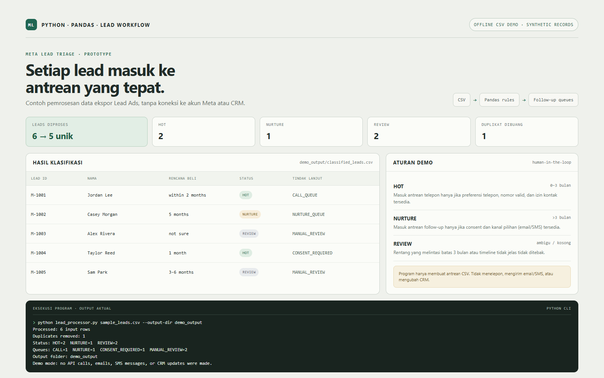

# Meta Lead CSV triage demo (Python + Pandas)

A local demo for classifying trailer/caravan leads exported as CSV. It illustrates a lead-processing layer; it does **not** connect to Meta, a CRM, Google Sheets, email, or SMS.



## Demo behavior

- Marks clear purchase timelines of **0–3 months** as `HOT`.
- Marks clear timelines **over 3 months** as `NURTURE`.
- Sends missing, unknown, or threshold-crossing timelines (for example `3-6 months`) to `REVIEW` rather than guessing.
- Removes duplicate non-empty `lead_id` values, keeping the first row.
- Creates `CALL_QUEUE` only when the lead is HOT, contact consent is present, the preferred contact is phone, and the phone looks valid.
- Creates `NURTURE_QUEUE` only when consent is present and the preferred email/SMS channel has a contact value.
- Routes missing consent to `CONSENT_REQUIRED`; ambiguous or incomplete data goes to `MANUAL_REVIEW`.
- Never sends a call, email, or SMS. It only writes queues for a person or downstream system to review.
- Leaves the source CSV unchanged.

`contact_consent` is a demo field. Confirm the client's actual consent language and local legal requirements before real outreach. A full integration also needs Meta Lead Ads permissions, a CRM/Google Sheets decision, notification delivery, and a monitored hosting schedule.

## Input columns

Required: `lead_id`, `name`, `phone`, `email`, `preferred_contact`, `purchase_timeline`, `contact_consent`.

Other fields such as `budget_range`, `trailer_size`, `travel_plan`, and `location` are preserved in the output.

## Run on Windows

```text
python -m pip install -r requirements.txt
python lead_processor.py sample_leads.csv --output-dir run_output
```

The sample is synthetic. It includes a duplicate lead, a near-term buyer, a later buyer, an unknown timeline, and a lead without contact consent.

Outputs:

- `classified_leads.csv` — all unique rows plus `lead_status` and `next_action`
- `hot_call_queue.csv` — leads eligible for a sales call queue
- `nurture_queue.csv` — consented leads with a valid preferred email/SMS channel
- `manual_review.csv` — ambiguous, incomplete, or consent-blocked leads
- `summary.json` — counts by status and next action

The output folder must be new or empty so previous results are not overwritten.

## Tests

```text
python -m unittest -v
```

## Live integration: not included in this demo

The demo intentionally uses a local CSV and synthetic data. Production use would require client-provided Meta app permissions and lead access, agreed field mappings and HOT rules, a chosen CRM or Google Sheets API integration, consent-compliant messaging, secret storage, retries, monitoring, and human-approved test submissions. Do not put API tokens or OAuth secrets in source code.
